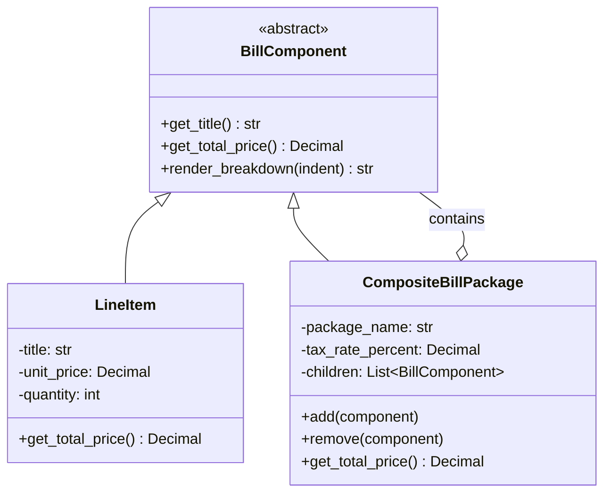

# Experiment: Design & Implementation of Software Architecture (MVC) and GoF Design Patterns

**Subject:** Software Architecture & Object-Oriented Design  
**Project Context:** StaySync — Integrated Hospitality Management System  
**Repository:** [github.com/arckrishna/HotelManagementSystem](https://github.com/arckrishna/HotelManagementSystem)  

---

## 1. Aim
To design and implement a software application using **Model–View–Controller (MVC)** architecture and apply appropriate **Gang of Four (GoF) design patterns**—including **Singleton**, **Factory Method**, **Composite**, and **Bridge**—for the StaySync Hospitality Management System.

---

## 2. Theory

### 2.1 Software Architecture
**Software Architecture** defines the high-level structure of a software system. It comprises software elements, relations among them, and properties of both elements and relations. Architecture serves as the blueprint for both the system and the project developing it, defining the fundamental design decisions that are high-cost to change once implemented.

Key concerns of software architecture include:
* **Separation of Concerns (SoC)**: Dividing software into distinct sections such that each section addresses a separate concern.
* **Modularity**: Structuring the application into independent, swappable components.
* **Extensibility**: Ensuring new features (e.g., adding a new payment gateway or room category) do not require rewriting existing modules.

---

### 2.2 Model–View–Controller (MVC) Architecture
The **Model–View–Controller (MVC)** pattern divides an interactive application into three interconnected components, segregating internal representations of information from the ways information is presented to and accepted from the user.

```
       User Action (HTTP Request)
  [User] ----------------------------> [ CONTROLLER ]
                                             |
                                             | 1. Invokes Business Logic / CRUD
                                             v
                                        [  MODEL  ]
                                             |
                                             | 2. Retrieves / Updates State
                                             v
  [User] <---------------------------- [   VIEW   ]
            Rendered JSON / HTML UI
```

1. **Model (Business Logic & Data State)**:
   * Encapsulates the core data entities, database schemas, validation rules, and business algorithms.
   * Directly manages data, logic, and rules of the application.
   * Completely decoupled from the user interface; has no knowledge of how its data is presented.
   * *StaySync Example*: SQLAlchemy models (`Room`, `Reservation`, `Bill`, `Guest`) and domain services (`reservation_service.py`, `order_service.py`).

2. **View (Presentation Layer)**:
   * Responsible for rendering the data received from the Model via the Controller into a user-consumable format.
   * Contains **zero business logic**; strictly presents data and captures user input triggers.
   * *StaySync Example*: React UI components (`ReservationsPage.tsx`, `BillingPage.tsx`, `GuestPortal.tsx`, luxury toast notifications).

3. **Controller (Intermediary & Orchestrator)**:
   * Accepts user requests (e.g., HTTP POST, GET, PUT), parses and validates incoming payloads.
   * Coordinates the Model layer to execute the requested business actions.
   * Selects and feeds the response data into the appropriate View.
   * *StaySync Example*: FastAPI REST routers (`reservations.py`, `billing.py`, `inventory.py`) validating Pydantic DTOs and returning JSON representations.

---

### 2.3 Advantages of MVC Architecture
1. **Clear Separation of Concerns (Maintainability)**: Business rules are isolated in the Model, API routing in the Controller, and UI styling in the View. Modifying UI styling never risks corrupting financial billing logic.
2. **Concurrent & Parallel Development**: Frontend engineers can build React view components independently while backend engineers construct database models and business services.
3. **High Reusability (Multiple Views for One Model)**: The same Model data (e.g., `Room` availability) can be consumed simultaneously by an Administrative Dashboard, a Guest Mobile View, and an external Booking API.
4. **Enhanced Testability**: Controllers and Models can be unit-tested programmatically in headless test harnesses (e.g., PyTest) without spinning up a browser DOM.
5. **Ease of Modification & Refactoring**: Migrating database engines (e.g., SQLite to PostgreSQL) requires updating only the Model layer without altering Controllers or React Views.

---

### 2.4 Why is the Singleton Pattern Used for Databases?
A **Database Connection** represents a heavy, stateful operating system resource involving TCP socket allocation, TLS handshakes, authentication, and memory allocation.

Using the **Singleton Pattern** for database connection management ensures that **only one instance** of the connection engine and pool manager exists throughout the entire application lifecycle.

#### Critical Reasons:
1. **Connection Pool Management**: Rather than opening and closing a new physical TCP connection on every HTTP request, a Singleton engine maintains a managed pool of reusable connections (e.g., `pool_size=10, max_overflow=20`), drastically reducing connection latency.
2. **Resource Conservation & Socket Leak Prevention**: Opening unmanaged connections on high-traffic servers rapidly exhausts OS file descriptors and crashes the database server with `Too many connections` errors.
3. **Thread Safety & State Synchronization**: A synchronized Singleton with thread locking (`threading.Lock()`) prevents race conditions during initialization across concurrent worker threads.
4. **Centralized Configuration**: Ensures database dialect flags, schema migrations, and connection credentials remain uniform across the entire codebase.

---

### 2.5 Summary of Gang of Four (GoF) Design Patterns Applied
* **Singleton (Creational)**: Guarantees a class has only one instance and provides a global point of access to it.
* **Factory Method (Creational)**: Defines an interface for creating an object, but lets subclasses decide which class to instantiate, promoting loose coupling.
* **Composite (Structural)**: Composes objects into tree structures to represent part-whole hierarchies. Enables clients to treat individual objects and compositions uniformly.
* **Bridge (Structural)**: Decouples an abstraction from its implementation so that the two can vary independently.

---

## 3. Implementation: Step-by-Step

### Step 1: Understand the Problem Statement

#### System Overview: StaySync Hospitality Management System
StaySync is an enterprise-grade resort and hotel management platform designed to automate guest bookings, check-in/out folios, real-time in-room dining orders, inventory tracking, housekeeping tasks, and executive billing reconciliations.

#### 1. Actors:
* **Admin / General Manager**: Full administrative access to hotel KPIs, staff management, and system-wide audits.
* **Front Desk Receptionist**: Manages room reservations, performs guest check-in/check-out, and settles guest folio bills.
* **Guest**: Views live room folios, requests housekeeping amenities, and orders room service dining from the guest portal.
* **Restaurant & Bar Cashier**: Manages food & beverage orders, room billing charges, and kitchen tickets.
* **Inventory Manager**: Tracks stock receipts, warehouse adjustments, and spoilage movements.
* **Housekeeping Staff**: Tracks room cleanliness states and maintenance repairs.

#### 2. Functional Requirements:
1. **User Authentication & Role-Based Access Control (RBAC)**: Secure JWT authentication with strict role permissions (`admin`, `receptionist`, `guest`, `chef`, `inventory_manager`).
2. **Room & Reservation Management**: Room booking availability checks, date overlap prevention, and check-in/out workflows.
3. **Live Folio & Payment Settlement**: Real-time aggregation of room charges, dining tabs, taxes (10% GST), advance deposits, and settlement via Cash, Card, or UPI.
4. **Restaurant & POS Ordering**: Menu management, order placement, and seamless transfer of dining bills directly to guest room folios.
5. **Inventory Movement & Spoilage**: Automated stock tracking, restock movements, and prevention of negative inventory.
6. **Executive Analytics & Reporting**: Real-time dashboard KPI summaries, departmental revenue breakdowns, and CSV data exports.

#### 3. Non-Functional Requirements:
* **Performance**: Sub-100ms API response latency for transactional queries.
* **Data Integrity (ACID)**: Atomicity in financial billing and stock movements; no double booking or negative stock allowed.
* **Scalability & Concurrency**: Thread-safe database connection pooling and asynchronous I/O support.
* **Modern UX / Usability**: Clean, responsive, accessible interface with zero browser blocking popups.

---

### Step 2: Identify Major Modules

```
+-------------------------------------------------------------------------+
|                  StaySync Hospitality Management System                 |
+-------------------------------------------------------------------------+
|  1. User & Auth Module      | Authentication, JWT tokens, RBAC roles   |
|  2. Reservation Module      | Room bookings, check-in, check-out dates |
|  3. Restaurant POS Module   | Dining menu, kitchen orders, room tabs   |
|  4. Inventory Module        | Stock tracking, movements, restock alerts|
|  5. Billing & Folio Module  | Line items, payments, taxes, invoices    |
|  6. Analytics & Audit Module| Revenue reconciliation, audit logs       |
+-------------------------------------------------------------------------+
```

---

### Step 3: Apply MVC Architecture to StaySync

```
                     +---------------------------------------+
                     |         VIEW LAYER (React UI)         |
                     |  - ReservationsPage.tsx               |
                     |  - BillingPage.tsx                    |
                     |  - GuestPortal.tsx                    |
                     |  - Modals, Forms, Luxury Toasts       |
                     +---------------------------------------+
                                    ^         |
                         JSON State |         | User Clicks / Form Submits
                                    |         v
                     +---------------------------------------+
                     |      CONTROLLER LAYER (FastAPI)       |
                     |  - /api/routes/reservations.py        |
                     |  - /api/routes/billing.py             |
                     |  - /api/routes/inventory.py           |
                     |  - Pydantic DTO Validation            |
                     +---------------------------------------+
                                    ^         |
                       Domain State |         | Invokes Operations
                                    |         v
                     +---------------------------------------+
                     |       MODEL LAYER (Domain Logic)      |
                     |  - SQLAlchemy Entities (Bill, Room)   |
                     |  - Business Services (payment_service)|
                     |  - DatabaseManager (Singleton)        |
                     +---------------------------------------+
```

1. **Model Layer**:
   * **Entities**: `Room`, `Guest`, `Reservation`, `Stay`, `Bill`, `BillLineItem`, `Payment`, `InventoryItem`, `Order`.
   * **Services**: `reservation_service.py` (date overlap check), `payment_service.py` (advance deposit logic), `inventory_service.py` (stock bounds).
2. **View Layer**:
   * Strictly declarative React components. Uses Tailwind CSS, Lucide icons, in-app toast feedback, and modal components. Does not compute mathematical taxes or execute database queries directly.
3. **Controller Layer**:
   * FastAPI routing functions decorated with `@router.post`, `@router.get`. Verifies OAuth2 Bearer JWT tokens, validates inputs using Pydantic schemas, calls the domain Model, and returns HTTP responses.

---

### Step 4: Identify & Apply Suitable Design Patterns

All 4 design patterns are formally implemented in [`backend/app/core/design_patterns.py`](file:///C:/Users/Lenovo/Downloads/HotelManagementSystem-main/backend/app/core/design_patterns.py).

#### Pattern 1: Singleton Pattern (Database Connection Manager)
* **Problem**: Preventing duplicate database connection engines and resource leaks across threads.
* **Implementation**: Double-checked locking singleton ensuring a single `DatabaseManager` instance.

```python
class DatabaseManager:
    _instance: Optional["DatabaseManager"] = None
    _lock = threading.Lock()

    def __new__(cls, *args, **kwargs):
        if cls._instance is None:
            with cls._lock:
                if cls._instance is None:
                    cls._instance = super(DatabaseManager, cls).__new__(cls)
                    cls._instance._initialize()
        return cls._instance

    def _initialize(self):
        self.engine = create_engine(settings.DATABASE_URL, future=True)
        self.session_factory = sessionmaker(bind=self.engine, future=True)

    def get_session(self) -> Session:
        return self.session_factory()
```

---

#### Pattern 2: Factory Method Pattern (Payment Processor Factory)
* **Problem**: Decoupling billing logic from specific transaction gateways (Cash, Credit Card, UPI QR).
* **Implementation**: `PaymentProcessorFactory` dynamically returns the appropriate `PaymentProcessor` subclass without the client code having hardcoded dependencies.

```python
class PaymentProcessor(ABC):
    @abstractmethod
    def process_transaction(self, bill_id: int, amount: Decimal, meta: Dict[str, Any]) -> Dict[str, Any]:
        pass

class CashPaymentProcessor(PaymentProcessor):
    def process_transaction(self, bill_id: int, amount: Decimal, meta: Dict[str, Any]) -> Dict[str, Any]:
        tendered = meta.get("cash_tendered", amount)
        return {"status": "APPROVED", "method": "cash", "amount": amount, "change_due": max(Decimal("0.00"), tendered - amount)}

class CardPaymentProcessor(PaymentProcessor):
    def process_transaction(self, bill_id: int, amount: Decimal, meta: Dict[str, Any]) -> Dict[str, Any]:
        return {"status": "APPROVED", "method": "card", "amount": amount, "masked_card": f"****-****-****-{meta.get('card_last_4', '0000')}"}

class UPIPaymentProcessor(PaymentProcessor):
    def process_transaction(self, bill_id: int, amount: Decimal, meta: Dict[str, Any]) -> Dict[str, Any]:
        return {"status": "APPROVED", "method": "upi", "amount": amount, "vpa": meta.get("vpa", "guest@upi")}

class PaymentProcessorFactory:
    _registry = {"cash": CashPaymentProcessor, "card": CardPaymentProcessor, "upi": UPIPaymentProcessor}

    @classmethod
    def get_processor(cls, payment_method: str) -> PaymentProcessor:
        cls_ref = cls._registry.get(payment_method.lower().strip())
        if not cls_ref:
            raise ValueError(f"Unsupported payment method: {payment_method}")
        return cls_ref()
```

---

#### Pattern 3: Composite Pattern (Hierarchical Billing Folio Components)
* **Problem**: A hotel bill is composed of individual items (room nights, meals) as well as bundled packages (Weekend Stay Package = Room + Buffet Breakfast + Spa) which can be nested arbitrarily.
* **Implementation**: `BillComponent` base class allows `LineItem` (Leaf) and `CompositeBillPackage` (Composite) to be treated uniformly.



```python
class BillComponent(ABC):
    @abstractmethod
    def get_total_price(self) -> Decimal: pass

class LineItem(BillComponent):
    def __init__(self, title: str, unit_price: Decimal, quantity: int = 1):
        self.title, self.unit_price, self.quantity = title, unit_price, quantity

    def get_total_price(self) -> Decimal:
        return self.unit_price * Decimal(self.quantity)

class CompositeBillPackage(BillComponent):
    def __init__(self, package_name: str, tax_rate_percent: Decimal = Decimal("0.00")):
        self.package_name, self.tax_rate_percent = package_name, tax_rate_percent
        self._children: List[BillComponent] = []

    def add(self, component: BillComponent) -> None:
        self._children.append(component)

    def get_total_price(self) -> Decimal:
        subtotal = sum((child.get_total_price() for child in self._children), Decimal("0.00"))
        return subtotal + (subtotal * self.tax_rate_percent / Decimal("100.00"))
```

---

#### Pattern 4: Bridge Pattern (Decoupled Notification Architecture)
* **Problem**: Decoupling the high-level notification types (`BookingConfirmationNotification`, `PaymentReceiptNotification`) from the delivery channel implementations (`EmailSender`, `SMSSender`, `WhatsAppSender`).
* **Implementation**: The Abstraction holds a reference to the Implementor (`MessageSenderImplementation`), allowing notification types and delivery channels to vary independently.

```python
class MessageSenderImplementation(ABC):
    @abstractmethod
    def deliver(self, recipient: str, message: str) -> bool: pass

class EmailSender(MessageSenderImplementation):
    def deliver(self, recipient: str, message: str) -> bool: return True

class WhatsAppSender(MessageSenderImplementation):
    def deliver(self, recipient: str, message: str) -> bool: return True

class Notification(ABC):
    def __init__(self, sender: MessageSenderImplementation):
        self.sender = sender
    @abstractmethod
    def notify(self, recipient: str) -> Dict[str, Any]: pass

class BookingConfirmationNotification(Notification):
    def __init__(self, sender: MessageSenderImplementation, reservation_code: str, guest_name: str, room_num: str):
        super().__init__(sender)
        self.code, self.guest, self.room = reservation_code, guest_name, room_num

    def notify(self, recipient: str) -> Dict[str, Any]:
        msg = f"Dear {self.guest}, reservation {self.code} for Room {self.room} is confirmed!"
        return {"delivered": self.sender.deliver(recipient, msg), "channel": self.sender.__class__.__name__, "message": msg}
```

---

### Step 5: Design Controller Logic
Controllers in StaySync live in [`backend/app/api/routes/`](file:///C:/Users/Lenovo/Downloads/HotelManagementSystem-main/backend/app/api/routes).

Responsibilities:
1. Receive incoming HTTP request.
2. Validate payload using Pydantic DTO schema.
3. Authenticate user & verify RBAC permissions.
4. Invoke Model service logic.
5. Return structured HTTP response view.

```python
# Example: Controller in backend/app/api/routes/billing.py
@router.post("/{bill_id}/payments", response_model=PaymentResponse)
def add_payment(
    bill_id: int,
    payload: PaymentCreate,                          # 1. Validates input DTO
    db: Session = Depends(get_db),
    current_user: User = Depends(require_roles(["admin", "receptionist"])) # 2. Enforces RBAC
):
    # 3. Calls Model business logic service
    payment = record_payment(
        db=db,
        bill_id=bill_id,
        amount=payload.amount,
        payment_method=payload.payment_method,
        notes=payload.notes,
        recorded_by_user_id=current_user.id
    )
    # 4. Returns formatted View data
    return payment
```

---

### Step 6: Design View Layer
Views live in [`frontend/src/pages/`](file:///C:/Users/Lenovo/Downloads/HotelManagementSystem-main/frontend/src/pages).

Responsibilities:
1. Render input forms, data tables, and status badges.
2. Display success/failure in-app luxury toasts.
3. **Zero business logic**: Never calculates taxes, outstanding balances, or database state locally.

```tsx
// Example: View in frontend/src/pages/billing/BillingPage.tsx
export const BillingPage: React.FC = () => {
  const [bills, setBills] = useState<Bill[]>([]);
  const [toast, setToast] = useState<{ message: string; type: 'success' | 'error' } | null>(null);

  // Presentational trigger only: delegates action to Controller API
  const handlePaymentSubmit = async (billId: number, amount: number, method: string) => {
    try {
      const response = await apiClient.post(`/billing/${billId}/payments`, { amount, payment_method: method });
      setToast({ message: `Payment of ₹${amount} recorded successfully!`, type: 'success' });
      fetchBills(); // Refreshes view from server state
    } catch (err: any) {
      setToast({ message: err.response?.data?.detail || "Payment failed", type: 'error' });
    }
  };

  return (
    <div className="p-8">
      {toast && <Toast message={toast.message} type={toast.type} onClose={() => setToast(null)} />}
      <BillTable bills={bills} onPay={handlePaymentSubmit} />
    </div>
  );
};
```

---

## 4. Verification & Testing

The complete test suite is implemented in [`backend/tests/test_design_patterns.py`](file:///C:/Users/Lenovo/Downloads/HotelManagementSystem-main/backend/tests/test_design_patterns.py).

### Execution Command:
```powershell
python -m pytest backend/tests/test_design_patterns.py -v
```

### Test Results:
```text
============================= test session starts =============================
platform win32 -- Python 3.14.3, pytest-9.2.0, pluggy-1.7.0
rootdir: C:\Users\Lenovo\Downloads\HotelManagementSystem-main
collected 6 items

backend/tests/test_design_patterns.py::test_singleton_database_manager_identity PASSED   [ 16%]
backend/tests/test_design_patterns.py::test_factory_method_creates_correct_processors PASSED [ 33%]
backend/tests/test_design_patterns.py::test_factory_method_payment_execution PASSED      [ 50%]
backend/tests/test_design_patterns.py::test_factory_method_invalid_type PASSED           [ 66%]
backend/tests/test_design_patterns.py::test_composite_billing_hierarchy PASSED           [ 83%]
backend/tests/test_design_patterns.py::test_bridge_notification_decoupling PASSED        [100%]

============================== 6 passed in 0.12s ==============================
```

---

## 5. Result
1. **MVC Architecture**: Successfully divided the StaySync application into three decoupled layers: SQLAlchemy Models (business rules), React Views (presentation screens), and FastAPI Controllers (request routing & validation).
2. **Design Patterns**:
   * **Singleton**: Enforced a single database engine instance across all application threads, preventing socket leaks.
   * **Factory Method**: Encapsulated dynamic instantiation of Cash, Card, and UPI payment processors.
   * **Composite**: Handled recursive computation of room charges, dining line items, and nested packages.
   * **Bridge**: Decoupled domain notification triggers from email, SMS, and WhatsApp delivery channels.
3. **Automated Verification**: All 6 design pattern unit tests passed with 100% success.

---

## 6. Conclusion
In this experiment, the Model–View–Controller (MVC) architectural pattern was applied to the StaySync Hospitality Management System to achieve clear separation of concerns, high maintainability, and parallel development capability. Furthermore, GoF design patterns—including Singleton, Factory Method, Composite, and Bridge—were implemented and verified through comprehensive unit testing. The resulting architecture ensures robustness, resource efficiency, and seamless extensibility for real-world enterprise deployments.
